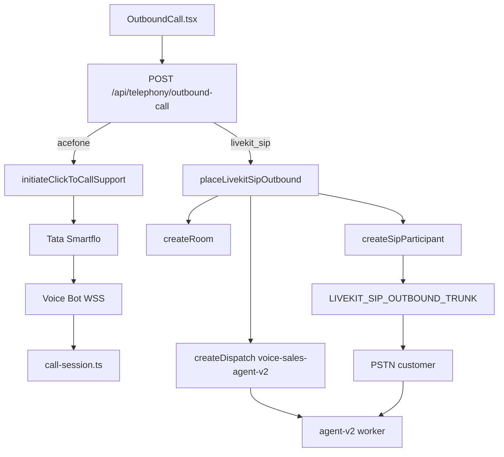

# HANDOFF / DEBUG REPORT — Voice Sales Agent (Real Phone Outbound)

**Generated:** 2026-09-16  
**Repo:** `/Users/manish/AI`  
**Scope:** Inspect-only audit of existing code + terminal logs. No secrets printed (masked).  
**Audience:** Next engineer / ChatGPT debugging outbound phone + LiveKit + Tata Smartflo/Acefone.

---

## SECTION 1: Project Overview

This monorepo is a **voice sales AI agent** product:

- **Agent Studio (frontend):** create/edit agents (prompts, product knowledge, skills, voice pipeline: Cascaded / OpenAI Realtime / Gemini Live).
- **Simulator (classic):** browser LiveKit room → legacy `apps/agent` worker.
- **Simulator 2.0:** browser LiveKit room → `apps/agent-v2` worker (`voice-sales-agent-v2`) — same worker used for LiveKit SIP phone.
- **Outbound Call page:** place **real PSTN outbound** calls to a customer mobile.

**Current focus (from code + recent work):**

| Mode | Status in product |
|------|-------------------|
| Outbound real phone | **Primary focus** (`/outbound`) |
| Simulator / Simulator 2.0 | Working paths for browser testing |
| LiveKit room testing | Yes (Sim 2.0 + SIP outbound) |
| Inbound LiveKit SIP | **Not implemented** in app code |
| Acefone Voice Bot callbacks | Supported (Dynamic endpoint) — used with Click-to-Call Support |

**Critical clarity:** There are **two separate real-phone outbound transports**. Mixing them causes “flow unclear / not ringing” confusion.

1. **Acefone / Smartflo / Tata Tele** — HTTP Click-to-Call Support → Voice Bot WebSocket → API `TelephonyCallSession` (in-process STT/LLM/TTS or Gemini/OpenAI S2S). **Default when Acefone keys are configured.**
2. **LiveKit SIP** — LiveKit Cloud room + agent-v2 dispatch + `SipClient.createSipParticipant` via outbound SIP trunk. **Optional; requires `LIVEKIT_SIP_OUTBOUND_TRUNK` + running `dev:agent-v2`.**

Docs (`docs/TELEPHONY-OUTBOUND.md`) label LiveKit as “recommended”; **code** recommends Acefone when Acefone is configured. That mismatch is a major source of confusion.

---

## SECTION 2: Current Architecture

### Path A — Acefone / Smartflo (default real phone)

```
User (Outbound UI)
  → POST /api/telephony/outbound-call { transport: "acefone" }
  → Prisma Call (provider=acefone, source=click-to-call)
  → POST https://api-smartflo.tatateleservices.com/v1/click_to_call_support
       (customer_number, api_key, async:1, caller_id, custom_identifier)
  → Tata Smartflo dials customer
  → On answer / Voice Bot connect:
       POST /api/telephony/voice/endpoint → returns wss_url (ngrok)
  → Acefone opens WSS → API /stream
  → TelephonyCallSession (call-session.ts)
       Cascaded: Azure STT → Groq/OpenAI LLM → Cartesia TTS (8 kHz μ-law)
       OR S2S: Gemini Live / OpenAI Realtime (in-API WebSocket clients)
  → Half-duplex: while agent speaks, caller audio not sent to model unless local barge
```

**Uses:** Tata **Click-to-Call Support API** (not plain Click-to-Call). **Not** LiveKit SIP for media. Direct SIP trunking only on the Tata side (opaque to this app).

### Path B — LiveKit SIP (Simulator 2.0 phone path)

```
User (Outbound UI)
  → POST /api/telephony/outbound-call { transport: "livekit_sip" }
  → Prisma Call (provider=livekit_sip, roomName=call-v2-{agentId}-{ts})
  → placeLivekitSipOutbound():
       1. RoomServiceClient.createRoom(metadata)
       2. AgentDispatchClient.createDispatch(room, "voice-sales-agent-v2")
       3. SipClient.createSipParticipant(trunkId, E.164 number, room, …)
  → LiveKit Cloud Outbound SIP trunk → PSTN (Telnyx/Twilio/etc. — configured in LiveKit Cloud, not in app)
  → Customer phone rings
  → SIP participant joins LiveKit room (attrs sip.callStatus, …)
  → agent-v2: waitForSipAnswered → AgentSession → STT/LLM/TTS or Gemini/OpenAI S2S
  → Hangup: delete LiveKit room
```

**Uses:**

| Mechanism | In this codebase? |
|-----------|-------------------|
| LiveKit SIP **outbound** trunk (`LIVEKIT_SIP_OUTBOUND_TRUNK`) | **Yes** |
| LiveKit SIP **inbound** trunk | **No** |
| LiveKit SIP **Dispatch Rule** APIs | **No** (uses explicit `AgentDispatchClient.createDispatch`) |
| `createSipParticipant` (SDK) | **Yes** |
| Tata Click-to-Call API (`/v1/click_to_call`) | **No** |
| Tata Click-to-Call **Support** API | **Yes** (Acefone path only) |
| Direct SIP URI dialing from app (without LiveKit) | **No** |



---

## SECTION 3: What Has Already Been Implemented

Check only if present in **application code** (not “assumed configured in cloud”).

- [x] LiveKit Cloud credentials used in code (`LIVEKIT_URL` / API key / secret)
- [x] Outbound SIP trunk **id** read from env (`LIVEKIT_SIP_OUTBOUND_TRUNK`) — trunk *creation* is outside repo (LiveKit Cloud UI)
- [ ] Tata SIP trunk configured **inside this repo** — N/A; Acefone path uses HTTP Support API; LiveKit trunk provider is external
- [x] Agent worker created (`apps/agent-v2`, name `voice-sales-agent-v2`)
- [x] Legacy agent worker exists (`apps/agent`, classic Simulator)
- [x] Room creation for LiveKit SIP outbound (`placeLivekitSipOutbound` → `createRoom`)
- [x] Agent dispatch before SIP dial (`createDispatch` then `createSipParticipant`)
- [x] SIP participant creation (`SipClient.createSipParticipant`)
- [x] SIP answer wait in agent-v2 (`waitForSipAnswered` on `sip.callStatus` / audio track)
- [x] Azure STT (cascaded agent-v2 + Acefone)
- [x] Groq LLM (cascaded when Studio LLM = groq)
- [x] Cartesia TTS (cascaded)
- [x] Gemini Live S2S (agent-v2 + Acefone `TelephonyGeminiLiveClient`)
- [x] OpenAI Realtime S2S (agent-v2 + Acefone)
- [x] Frontend Outbound call button + transport selector (`OutboundCall.tsx`)
- [x] Frontend Agent Studio + Simulator + Simulator 2.0
- [x] Acefone Click-to-Call Support dial + hangup
- [x] Acefone Voice Bot Dynamic endpoint + WSS `/stream`
- [x] Telephony SSE events for UI logs/status
- [x] Phone number normalize (10-digit India → Acefone digits / LiveKit `+91…`)
- [x] Gemini 3.1 → 2.5 remap on telephony (Acefone + agent-v2)
- [x] Telephony noise cancellation preference (Telephony BVC on SIP; Krisp off on trunk create)
- [x] Nexora hotel lookup tool (agent-v2 + Acefone tools)
- [x] Lead capture / callback / end_call tools
- [x] Docs: `docs/TELEPHONY-OUTBOUND.md`

---

## SECTION 4: What Is Pending / Not Implemented

- [ ] LiveKit **inbound** SIP trunk handling in app code
- [ ] LiveKit **SIP Dispatch Rules** managed in code
- [ ] Plain Tata `/v1/click_to_call` (non-Support) API
- [ ] LiveKit SIP call DB status `ringing` → `in-progress` when customer answers (Acefone does this via webhooks/endpoint; LiveKit often stays `ringing` until hangup)
- [ ] Orphan / no-answer reconciler for `source: livekit-sip` (orphans currently target Acefone `click-to-call`)
- [ ] Bridging agent-v2 live telemetry into telephony SSE like Acefone `call-session` agent_state
- [ ] Structured logs from Section 11 (`OUTBOUND_CALL_REQUEST`, `LIVEKIT_SIP_*`, etc.) — **not present** as named events today
- [ ] `.env.example` complete Acefone/Smartflo block (present in real `apps/api/.env`, incomplete in example)
- [ ] Central startup env validator (fail-at-use throws only)
- [ ] Perfect duplex on Acefone (by design half-duplex + local barge)
- [ ] Property-type filter on Nexora city lookup (hostel vs hotel) — product bug, not dial bug
- [ ] Guaranteed single-speak after hotel tool (duplicate force-speak / model speak possible)

---

## SECTION 5: Current Outbound Call Flow in Code

### 5.1 Frontend

**File:** `apps/web/src/pages/OutboundCall.tsx`  
**Functions:** `placeCall` (handler), transport state `acefone | livekit_sip`  
**Input:** agentId, toNumber, prospectName, contactEmail, transport, optional pipeline override  
**Calls:** `initiateOutboundCall(...)` in `apps/web/src/api.ts`  
**Output:** UI shows callId, SSE logs, status  
**Actually called?** **Yes** — Place call button.

**File:** `apps/web/src/api.ts`  
**Function:** `initiateOutboundCall`  
**Purpose:** `POST ${API}/telephony/outbound-call`  
**Also:** `getTelephonyTransports` → `GET /api/telephony/transports`

### 5.2 Backend — shared entry

**File:** `apps/api/src/telephony/routes.ts`  
**Function:** `telephonyRouter.post('/outbound-call', …)`  
**Input (zod):** `agentId`, `toNumber`, optional `prospectName`, `contactEmail`, `transport`, `voicePipeline`, `realtimeS2sConfig`  
**Default transport:** `parsed.transport ?? (acefoneReady ? 'acefone' : 'livekit_sip')`  
**Branches:** LiveKit SIP block (~211–367) **or** Acefone block (~370+)

### 5.3 LiveKit SIP branch

**File:** `apps/api/src/telephony/livekit-sip.ts`  

| Function | Purpose | Returns |
|----------|---------|---------|
| `isLivekitSipConfigured()` | Env gate | boolean |
| `livekitSipConfigError()` | Missing env message | string \| null |
| `buildLivekitSipSessionMeta(...)` | Room/participant metadata JSON + v2 session | `{ roomMetadata, participantMetadata, v2Session }` |
| `placeLivekitSipOutbound(...)` | createRoom → createDispatch → createSipParticipant | `{ sipParticipantIdentity }` |
| `hangupLivekitSipRoom(roomName)` | `deleteRoom` | void |

**Input to `placeLivekitSipOutbound`:** `roomName`, `toNumber` (E.164), metadata strings, optional `fromNumber`, `waitUntilAnswered`  
**Called from:** outbound-call route with **`waitUntilAnswered: false`**  
**Hangup:** `POST /api/telephony/calls/:callId/hangup` when `provider === 'livekit_sip'`

### 5.4 Acefone branch

**File:** `apps/api/src/telephony/acefone-client.ts`  

| Function | Purpose |
|----------|---------|
| `initiateClickToCallSupport` | POST Tata Support API |
| `hangupSmartfloCall` | POST `/v1/call/hangup` |

**File:** `apps/api/src/telephony/call-session.ts`  
**Class:** `TelephonyCallSession` — media, STT/LLM/TTS or S2S, barge, hangup  
**Started from:** `apps/api/src/telephony/ws-server.ts` on WSS connect

**File:** `apps/api/src/telephony/ws-server.ts`  
**Functions:** `attachTelephonyWebSocket`, `publicWssUrl`

### 5.5 Agent worker (LiveKit SIP + Simulator 2.0)

**File:** `apps/agent-v2/src/main.ts`  
**Functions:** `waitForSipAnswered`, agent `entry`, `boot` → `cli.runApp` agentName `voice-sales-agent-v2`  
**Load agent:** `apps/agent-v2/src/load-agent.ts` → `GET /api/simulator2/agents/:id/runtime`

---

## SECTION 6: Important Files List

### A. LiveKit

| Path | Purpose | Status | Problem noticed |
|------|---------|--------|-----------------|
| `apps/api/src/telephony/livekit-sip.ts` | SIP dial + dispatch | Implemented | Limited dial success logging |
| `apps/api/src/routes/livekit.ts` | Classic sim token (legacy agent) | Implemented | Not used for SIP outbound |
| `apps/api/src/simulator2/livekit.ts` | Sim 2.0 token + agent dispatch via JWT | Implemented | Browser only |
| `apps/agent-v2/src/main.ts` | Worker entry / SIP wait | Implemented | On answer timeout, may start anyway |
| `docs/TELEPHONY-OUTBOUND.md` | Ops docs | Present | Says LiveKit “recommended”; code prefers Acefone |

### B. SIP trunk

| Path | Purpose | Status | Problem |
|------|---------|--------|---------|
| `apps/api/src/telephony/livekit-sip.ts` | Uses `LIVEKIT_SIP_OUTBOUND_TRUNK` | Env-driven | Trunk provisioning not in code |
| LiveKit Cloud UI | Outbound trunk to Tata/Telnyx/etc. | External | Must verify provider can dial India |

### C. Tata Tele / Smartflo / Acefone

| Path | Purpose | Status | Problem |
|------|---------|--------|---------|
| `apps/api/src/telephony/acefone-client.ts` | Support API + hangup | Implemented | Requires both Bearer token + body api_key |
| `apps/api/src/telephony/routes.ts` | `/voice/endpoint`, webhooks, outbound | Implemented | Typo `sucess` kept for Acefone |
| `apps/api/src/telephony/call-session.ts` | Phone media session | Implemented | Half-duplex complexity |
| `apps/api/src/telephony/ws-server.ts` | WSS `/stream` | Implemented | Needs public ngrok URL |

### D. Outbound call

| Path | Purpose | Status | Problem |
|------|---------|--------|---------|
| `apps/web/src/pages/OutboundCall.tsx` | UI | Implemented | Easy to pick wrong transport |
| `apps/web/src/api.ts` | Client API | Implemented | Stale comment about hiding Acefone |
| `apps/api/src/telephony/routes.ts` | Server outbound | Implemented | Dual path |

### E. Agent worker

| Path | Purpose | Status | Problem |
|------|---------|--------|---------|
| `apps/agent-v2/src/main.ts` | LiveKit agent | Required for SIP + Sim2 | Must stay registered |
| `apps/agent-v2/src/voice-agent.ts` | Agent + tools | Implemented | — |
| `apps/agent-v2/src/load-agent.ts` | Runtime fetch | Needs `API_URL` | Fail if API down |
| `apps/agent/src/*` | Classic sim only | Separate | Not SIP |

### F. STT

| Path | Purpose | Status | Problem |
|------|---------|--------|---------|
| `apps/agent-v2/src/azure-stt.ts`, `stt-factory.ts` | Cascaded STT | Implemented | — |
| `apps/api/src/telephony/azure-push-stt.ts` | Phone cascaded | Implemented | OpenAI STT forced off on phone |

### G. TTS

| Path | Purpose | Status | Problem |
|------|---------|--------|---------|
| `apps/agent-v2/src/multilingual-tts.ts` | Cascaded Cartesia | Implemented | Unused on S2S |
| `apps/api/src/telephony/cartesia-telephony-tts.ts` | Phone μ-law TTS | Implemented | — |

### H. LLM

| Path | Purpose | Status | Problem |
|------|---------|--------|---------|
| `apps/agent-v2/src/llm-factory.ts` | Groq/OpenAI | Cascaded | — |
| `apps/api/src/telephony/llm-client.ts` | Phone cascaded LLM | Implemented | — |
| `apps/agent-v2/src/gemini-live-factory.ts` | Gemini Live | Implemented | 3.1 remapped on phone |
| `apps/api/src/telephony/telephony-gemini-live-client.ts` | Acefone Gemini | Implemented | Session internal errors observed |

### I. Frontend call UI

| Path | Purpose | Status | Problem |
|------|---------|--------|---------|
| `apps/web/src/pages/OutboundCall.tsx` | Outbound | Implemented | — |
| `apps/web/src/pages/Studio.tsx` | Agent tab | Implemented | — |
| `apps/web/src/pages/Simulator.tsx` / `Simulator2.tsx` | Sims | Implemented | — |
| `apps/web/src/App.tsx` | Routes | Implemented | — |

### J. Environment / config

| Path | Purpose | Status | Problem |
|------|---------|--------|---------|
| `apps/api/.env` | Runtime secrets | Present locally | **Do not share raw**; incomplete example |
| `.env.example` | Template | Incomplete Acefone | Update pending |
| `apps/agent-v2/src/load-env.ts` | Loads root + api env | Implemented | — |
| `package.json` | Scripts `dev:api`, `dev:web`, `dev:agent-v2` | Implemented | — |

---

## SECTION 7: Environment Variables

**Do not commit or paste real values.** Masking style: `API****`, `ST_****`, `sk_****`, `gsk_****`, `AIza****`.

### LiveKit

| Variable | Where used | Required | Validation | Logs expose secret? |
|----------|------------|----------|------------|---------------------|
| `LIVEKIT_URL` | livekit-sip, tokens, agent-v2 | Yes for LK | `livekitSipConfigError` | URL logged (ok) |
| `LIVEKIT_API_KEY` | SDK clients | Yes | Same | Should not log full key |
| `LIVEKIT_API_SECRET` | SDK clients | Yes | Same | Must not log |
| `LIVEKIT_SIP_OUTBOUND_TRUNK` | `createSipParticipant` | Yes for SIP | Same | Trunk id ok to log |
| `LIVEKIT_SIP_FROM_NUMBER` | SIP fromNumber | Optional | Fallback `ACEFONE_FROM_NUMBER` | Mask in new logs |

**Local presence (masked):** `LIVEKIT_URL=wss://test-****.livekit.cloud`, key `API****`, trunk `ST_****`, from `9192****`.

### Tata / Smartflo / Acefone

| Variable | Where used | Required | Validation | Logs |
|----------|------------|----------|------------|------|
| `ACEFONE_CLICK_TO_CALL_API_KEY` / `SMARTFLO_CLICK_TO_CALL_API_KEY` | body `api_key` | Yes for Acefone | throw in client | Do not log |
| `SMARTFLO_API_TOKEN` / `ACEFONE_API_TOKEN` / `TATA_API_TOKEN` | Bearer | Yes for Acefone | throw | Do not log |
| `ACEFONE_FROM_NUMBER` | caller_id | Strongly recommended | optional in body | Mask |
| `ACEFONE_API_BASE_URL` / `SMARTFLO_API_BASE_URL` | default Tata host | Optional | default `api-smartflo.tatateleservices.com` | ok |
| `TELEPHONY_WSS_PUBLIC_URL` | Voice Bot WSS | **Yes** for Acefone media | `publicWssUrl` | URL ok |

### Azure

| Variable | Used | Required | Validation |
|----------|------|----------|------------|
| `AZURE_SPEECH_KEY` | STT | Cascaded | Boot probe agent-v2 |
| `AZURE_SPEECH_REGION` | STT | Yes with key | — |
| `AZURE_SPEECH_ENDPOINT` | STT | Optional | — |
| `TELEPHONY_STT` | — | **Dead** (set in .env, not read in src) | — |

### Groq

| Variable | Used | Required |
|----------|------|----------|
| `GROQ_API_KEY` | Cascaded LLM | When provider=groq |
| `GROQ_MODEL` | Model id | Optional default |
| `GROQ_FALLBACK_MODEL` | Fallback | Optional |

### Cartesia

| Variable | Used | Required |
|----------|------|----------|
| `CARTESIA_API_KEY` | Cascaded TTS | Cascaded |
| `CARTESIA_VOICE_ID` | Voice | Cascaded |
| `CARTESIA_MODEL_ID` | Model | Optional |

### OpenAI / Gemini

| Variable | Used | Required |
|----------|------|----------|
| `OPENAI_API_KEY` | GPT / Realtime / OpenAI STT sim | Realtime routes 400 if missing |
| `OPENAI_MODEL` / `OPENAI_SIMULATOR2_MODEL` / `OPENAI_REALTIME_MODEL` | Models | Optional |
| `GEMINI_API_KEY` / `GOOGLE_API_KEY` | Gemini Live | gemini_live 400 if missing |
| `GEMINI_LIVE_ALLOW_31_ON_PHONE` | Keep 3.1 on phone | Optional (`1`) |

### App / misc

| Variable | Used | Notes |
|----------|------|-------|
| `API_URL` | Public API for Acefone callbacks + agent-v2 fetch | Locally set to ngrok HTTPS |
| `API_PORT` | 3001 | — |
| `CORS_ORIGIN` | Web | — |
| `DATABASE_URL` | Prisma | — |
| `LATENCY_PROFILE` | Telephony latency | `low` used |
| `NOISE_CANCELLATION` | agent-v2 NC mode | Optional |
| `NEXORA_FACTS_QUERY_URL` / `NEXORA_INGEST_TOKEN` | Hotel facts | Optional for stay agents |
| `CALL_COMPLETED_WEBHOOK_URL` / `TELEPHONY_WEBHOOK_URL` | Outbound webhooks from us | Optional |
| `SARVAM_API_KEY` | Alt STT | Optional |

**Missing validation:** No single boot-time schema for all telephony envs. Acefone vs LiveKit validated separately at `/transports` and `/outbound-call`.

---

## SECTION 8: LiveKit SIP Configuration in Code

**SDK equivalent (not REST JSON object literally):**

```ts
await sip.createSipParticipant(trunkId, opts.toNumber, opts.roomName, {
  participantIdentity: `sip-${digits}`,
  participantName: opts.toNumber,
  participantMetadata: opts.participantMetadata,
  fromNumber: fromNumber || undefined,
  playDialtone: true,
  waitUntilAnswered: opts.waitUntilAnswered ?? false, // route passes FALSE
  krispEnabled: false,
  ringingTimeout: 45,
  maxCallDuration: 60 * 30,
  timeout: opts.waitUntilAnswered ? 60 : 20,
});
```

| Question | Answer |
|----------|--------|
| Where `sip_trunk_id` comes from | `process.env.LIVEKIT_SIP_OUTBOUND_TRUNK` |
| Where customer number comes from | UI `toNumber` → normalize → E.164 (`+91` + 10 digits) |
| Phone format | LiveKit: `+91XXXXXXXXXX`; Acefone: digits without `+` |
| `waitUntilAnswered` | **false** on outbound-call (HTTP returns while ringing) |
| SIP status logged? | Agent-v2 logs status transitions; API only sets DB `ringing` after dial starts — **no rich SipCallError structured log** |
| SipCallError caught? | Generic `catch` on outbound-call → mark call failed + delete room; **not** typed SipCallError handling |
| Room exists before call? | **Yes** — `createRoom` first |
| Agent joined before call? | **Dispatch created before** `createSipParticipant`; worker must already be registered; join is async |

---

## SECTION 9: Tata / Smartflo Integration

**Uses Tata/Smartflo HTTP directly on Acefone path. LiveKit SIP path does not call Tata HTTP** (trunk may still terminate on Tata/Telnyx behind LiveKit).

### Click-to-Call Support (implemented)

- **Endpoint:** `POST {base}/v1/click_to_call_support`  
  Default base: `https://api-smartflo.tatateleservices.com`
- **Headers:** `Authorization: Bearer {SMARTFLO_API_TOKEN}`, `content-type: application/json`
- **Body:**
  - `customer_number` (digits)
  - `api_key` (Click-to-Call Support key)
  - `async: 1` (**yes**)
  - optional `caller_id` (from `ACEFONE_FROM_NUMBER`, `+` stripped)
  - optional `custom_identifier`: `{ call_id, vsaCallId }` (hyphens stripped from UUID)
  - optional `customer_ring_timeout`
- **Response:** `{ success, message?, ref_id?, raw }` — `ref_id` returned; call row also stores provider ids from later WSS/events
- **Hangup:** `POST /v1/call/hangup` `{ call_id: callSid }`
- **Webhooks / Dynamic endpoint:**
  - `POST /api/telephony/voice/endpoint` — must answer ≤2s; returns `{ sucess, success, wss_url }`
  - `POST /api/telephony/webhooks/call-status` — status mapping
- **Error handling:** non-OK HTTP → throw with extracted message; `success: false` → call marked failed
- **agent_number:** **Not** sent in this Support API body (Support API targets Voice Bot destination configured in portal)
- **customer_number / caller_id:** from UI + env as above

### Plain Click-to-Call

**Not implemented** (`/v1/click_to_call` unused).

---

## SECTION 10: Exact Current Issue

**Symptom (user):** trunk/integration “seems done” but outbound **not ringing / call not coming / flow unclear**.

### Classification (evidence-based — multiple issues possible)

| Code | Assessment |
|------|------------|
| **A** Frontend not calling backend | **Unlikely** if UI Place call used — wired to `initiateOutboundCall`. Evidence: Acefone WSS start events in API logs. |
| **B** Backend not calling LiveKit dial | **Possible if transport=acefone** — then LiveKit `createSipParticipant` is **never** called. Code default recommends Acefone. |
| **C** `createSipParticipant` fails | **Unconfirmed** without a failed LiveKit outbound attempt log in latest terminals. Catch path exists. |
| **D/E** SIP/Tata trunk reject | **Unclear** for LiveKit without LiveKit Cloud SIP logs. Acefone dials have succeeded recently. |
| **F** Number format | Partially mitigated (`normalizePhone` + `+91`). Wrong format still possible for non-India. |
| **G** Caller ID not allowed | Possible on Tata if `ACEFONE_FROM_NUMBER` not authorized — would show as Support API error message. |
| **H** Agent not joining room | LiveKit path needs `npm run dev:agent-v2` registered. Logs show reconnect failures then re-register. |
| **I** TTS before answer | Mitigated on LiveKit (`waitForSipAnswered`); Acefone starts after Voice Bot `start`. Timeout path may still open early. |
| **J** Silent audio | Possible (NC, Gemini, half-duplex) after connect — separate from “no ring.” |
| **K** Webhook/status logs missing | **Yes for LiveKit** — DB often stays `ringing`; Section 11 structured logs missing → hard to debug. |

### Strongest evidence from recent terminals

1. **Acefone path works enough to connect media** (API `171776`):
   - `[telephony] start event` with `from`/`to`, then `Starting gemini_live model=…`
   - So “never dials” is **false for Acefone** in that window.
2. **Gemini Live died mid-call (Acefone):** UI `Gemini Live WebSocket closed (Internal error occurred.)`
3. **API briefly broken by TransformError** (partial private-field edit), then recovered and accepted another call.
4. **agent-v2 LiveKit worker** (`171774`): intermittent `failed to connect to LiveKit server` / `worker connection closed unexpectedly` (code 1006), then re-registered as `voice-sales-agent-v2`.
5. **Web vite proxy errors** when API down → Studio/Outbound cannot load agents/transports.

### Likely root cause of “flow unclear”

**Two transports + Acefone default + docs saying LiveKit recommended.** User may configure LiveKit trunk, click Place call, and still hit Acefone — or vice versa — without noticing the transport dropdown.

If the issue is specifically **LiveKit not ringing**: verify transport=`livekit_sip`, trunk dials India, agent-v2 registered, and LiveKit Cloud SIP attempt logs (app logs alone are thin).

---

## SECTION 11: Logs Needed (not yet implemented — recommend adding later)

Do **not** implement in this handoff task; add in a follow-up PR.

Required named logs:

1. **OUTBOUND_CALL_REQUEST** — callId, roomName, customerNumberMasked, sipTrunkId (if LiveKit), callerIdMasked, transport  
2. **LIVEKIT_ROOM_CREATED** — roomName, roomSid (if SDK returns)  
3. **LIVEKIT_SIP_PARTICIPANT_CREATE_REQUEST** — roomName, sipTrunkId, sipCallToMasked, participantIdentity, waitUntilAnswered  
4. **LIVEKIT_SIP_PARTICIPANT_CREATED** — participantSid, sipCallStatus  
5. **LIVEKIT_SIP_CALL_FAILED** — sipStatusCode, sipStatus, errorMessage  
6. **AGENT_JOINED_ROOM** — roomName, agentName  
7. **CUSTOMER_ANSWERED** — participantIdentity, sipCallStatus  
8. **TTS_STARTED** / opener started — roomName, text preview  
9. **CALL_ENDED** — reason, duration  

Also for Acefone: log Support API `success`, `ref_id`, HTTP status (no api_key/token).

---

## SECTION 12: Errors Found

### A. Gemini Live (Acefone UI / session)

```
Gemini Live WebSocket closed (Internal error occurred.)
```

(From call UI ~11:54; Google-side session close after Acefone Gemini pipeline started.)

### B. API TransformError (tsx/esbuild — transient during edit)

```
Error [TransformError]: Transform failed with 5 errors:
.../telephony-gemini-live-client.ts: ERROR: Private name "#userMulawBytesSinceEou" must be declared in an enclosing class
.../telephony-gemini-live-client.ts: ERROR: Private name "#lastAudioStreamEndAt" must be declared in an enclosing class
```

Later the file gained field declarations and API restarted successfully. **Risk:** if declaration and usage drift again, `dev:api` crashes and Outbound cannot dial.

### C. agent-v2 LiveKit worker disconnect

```
WARN: failed to connect to LiveKit server (wss://test-****.livekit.cloud), retrying in 2 seconds: (1/10)
error: APIStatusError: worker connection closed unexpectedly
statusCode: 1006
...
INFO: registered worker agentName: "voice-sales-agent-v2"
```

### D. Vite proxy when API down

```
[vite] http proxy error: /api/agents
[vite] http proxy error: /api/telephony/transports
```

### E. Acefone call lifecycle (success path evidence)

```
[telephony] start event { callSid: 'CAGE…', from: '+9192…', to: '+9197…', direction: 'outbound' }
[telephony] Starting gemini_live model=gemini-2.5-flash-native-audio-preview-12-2025 …
[telephony] First media event { … }
```

### F. Not found in recent app terminals

- Explicit `SipCallError` stack
- HTTP 403/404/408/480/486 from `createSipParticipant` in app logs
- Tata Support API failure body for the latest Acefone connects (those dials reached Voice Bot)

---

## SECTION 13: How to Reproduce

### Shared setup

```bash
# Terminal 1 — public URL for Acefone (if testing Acefone)
ngrok http 3001
# Set API_URL + TELEPHONY_WSS_PUBLIC_URL to the ngrok https/wss URLs in apps/api/.env

# Terminal 2
cd /Users/manish/AI && npm run dev:api

# Terminal 3
npm run dev:web

# Terminal 4 — REQUIRED for LiveKit SIP / Simulator 2.0
npm run dev:agent-v2
```

Open: `http://localhost:5173/outbound`

### Reproduce Acefone (default)

1. Transport: **Acefone / Smartflo**
2. Enter mobile `+91XXXXXXXXXX` / 10 digits
3. Select agent (Gemini Live or Cascaded)
4. Click **Place call**
5. **Expected:** Customer phone rings; on answer Voice Bot WSS connects; agent speaks  
6. **Actual (recent):** Ring + connect worked; Gemini Internal error / unnatural conversation possible  
7. **Logs:** API `[telephony] start event` / `Starting gemini_live`

### Reproduce LiveKit SIP

1. Confirm `GET /api/telephony/transports` → `livekit_sip: true`
2. Transport: **LiveKit SIP**
3. Ensure agent-v2 shows `registered worker` / `voice-sales-agent-v2`
4. Place call
5. **Expected:** Customer rings via LiveKit trunk; agent joins after answer  
6. **Actual:** Unclear without a dedicated recent LiveKit dial log — capture API SSE + agent-v2 console + LiveKit Cloud SIP logs  
7. If transport left on Acefone while debugging LiveKit trunk → **false negative**

### Reproduce “API down / no agents”

1. Stop `dev:api`
2. Open Studio/Outbound  
3. Actual: vite proxy errors; “Cannot load agents”

---

## SECTION 14: Recommended Fix Plan

### Phase 1 — Confirm frontend → backend

- **Check:** Network tab `POST /api/telephony/outbound-call` body includes `transport`
- **File:** `OutboundCall.tsx`, `api.ts`
- **Expected:** 200 with `callId`, `transport` echoed

### Phase 2 — Confirm correct dial function

- **Check:** Response `transport` and API log category (`smartflo` vs `livekit`)
- **File:** `routes.ts`
- **Expected:** Acefone → `initiateClickToCallSupport`; LiveKit → `placeLivekitSipOutbound`
- **Modify later:** Align docs/UI default with intended primary transport; add Section 11 logs

### Phase 3 — Confirm LiveKit trunk dial

- **Check:** LiveKit Cloud SIP outbound attempts; app catch error message
- **File:** `livekit-sip.ts`
- **Expected:** SIP INVITE to customer; no immediate createSipParticipant throw

### Phase 4 — Confirm Tata accepts (Acefone path)

- **Check:** Support API `success:true`, `ref_id`; portal CDR
- **File:** `acefone-client.ts`
- **Expected:** Ring starts; Voice Bot endpoint hit on answer

### Phase 5 — Confirm customer phone rings

- **Check:** Handset; caller ID = `ACEFONE_FROM_NUMBER` / `LIVEKIT_SIP_FROM_NUMBER`
- **Expected:** Audible ring

### Phase 6 — Confirm AI joins after answer

- **Acefone:** WSS `start` → session pipeline  
- **LiveKit:** `waitForSipAnswered` → `AgentSession` → opener `generateReply`  
- **Files:** `call-session.ts`, `agent-v2/main.ts`  
- **Expected:** No opener before answer (except documented timeout fallback)

### Phase 7 — Confirm STT/TTS / S2S audio

- Cascaded: Azure + Groq + Cartesia  
- S2S: Gemini/OpenAI; Acefone half-duplex expectations  
- **Files:** factories + `telephony-gemini-live-client.ts`  
- **Expected:** Bidirectional audio; fix Gemini Internal error / EOU if session drops

**Immediate stability fixes (after handoff, separate PR):**

1. Ensure `telephony-gemini-live-client.ts` private fields stay declared (API must not TransformError).  
2. Pick one primary transport; fix docs vs `recommended`.  
3. Add structured LiveKit SIP logs.  
4. Update LiveKit call status on answer.  
5. Product: hostel vs hotel Nexora routing + duplicate speak.

---

## SECTION 15: Files I Should Share With ChatGPT

### Must-share (top priority)

1. `apps/api/src/telephony/routes.ts` — outbound entry + both transports  
2. `apps/api/src/telephony/livekit-sip.ts` — createRoom / dispatch / createSipParticipant  
3. `apps/api/src/telephony/acefone-client.ts` — Tata Support API  
4. `apps/agent-v2/src/main.ts` — SIP answer wait + session  
5. `apps/web/src/pages/OutboundCall.tsx` — UI transport + Place call  

### Also useful

- `apps/api/src/telephony/call-session.ts` — Acefone media orchestrator  
- `apps/api/src/telephony/ws-server.ts` — WSS  
- `apps/agent-v2/src/gemini-live-factory.ts`, `latency-profile.ts`, `noise-cancellation.ts`, `tools.ts`  
- `apps/api/src/telephony/telephony-gemini-live-client.ts`  
- `docs/TELEPHONY-OUTBOUND.md`  
- `.env.example` (not real `.env`)  
- Root `package.json`  
- Latest terminal logs: API (`dev:api`), agent-v2 (`dev:agent-v2`), ngrok  
- LiveKit Cloud SIP attempt logs (export from console)  
- Tata/Smartflo CDR / webhook samples (redact PII)

**Never paste:** raw `apps/api/.env` secrets.

---

## SECTION 16: Summary for ChatGPT

```
We are building an outbound AI voice agent in a monorepo with TWO real-phone transports:

(1) Acefone/Smartflo Tata Click-to-Call Support API → Voice Bot WSS → apps/api TelephonyCallSession (Azure/Groq/Cartesia or Gemini/OpenAI S2S). This is the CODE DEFAULT when Acefone keys exist.

(2) LiveKit SIP outbound: createRoom + AgentDispatchClient("voice-sales-agent-v2") + SipClient.createSipParticipant(LIVEKIT_SIP_OUTBOUND_TRUNK), then agent-v2 waits for sip.callStatus=active before opener. Same worker as Simulator 2.0.

Completed work: both dial paths implemented; Studio + Simulator + Outbound UI; STT/LLM/TTS and S2S; SIP answer wait; telephony BVC; Gemini 3.1→2.5 remap on phone.

Current flow confusion: docs say LiveKit recommended; code recommends Acefone. Recent Acefone calls DID connect (start event + gemini_live) but Gemini Live closed with "Internal error occurred." agent-v2 showed intermittent LiveKit worker disconnect (1006) then re-register. Structured LIVEKIT_SIP_* logs and ringing→in-progress for LiveKit are missing.

Important files: apps/api/src/telephony/routes.ts, livekit-sip.ts, acefone-client.ts, call-session.ts; apps/agent-v2/src/main.ts; apps/web/src/pages/OutboundCall.tsx; docs/TELEPHONY-OUTBOUND.md.

We need help debugging: (a) confirm which transport was selected when "phone not ringing"; (b) LiveKit createSipParticipant / trunk / India dial if LiveKit selected; (c) Acefone Gemini session stability if Acefone selected; (d) add proper SIP status logging and align default transport with product intent.
```

---

## Appendix: Run scripts

```bash
npm run dev:api        # @vsa/api — telephony + REST
npm run dev:web        # Vite Studio / Outbound
npm run dev:agent-v2   # LiveKit SIP + Simulator 2.0 worker
npm run dev:agent      # Classic Simulator only
```

## Appendix: Endpoint cheat sheet

| Method | Path | Role |
|--------|------|------|
| GET | `/api/telephony/transports` | Which transports configured + recommended |
| POST | `/api/telephony/outbound-call` | Start outbound |
| POST | `/api/telephony/voice/endpoint` | Acefone Dynamic Voice Bot |
| POST | `/api/telephony/webhooks/call-status` | Provider status |
| POST | `/api/telephony/calls/:id/hangup` | Hangup |
| GET | `/api/telephony/calls/:id/events` | SSE |
| WSS | `/stream?callId=` | Acefone media |
| POST | `/api/simulator2/livekit/token` | Browser Sim 2.0 |

---

*End of HANDOFF_REPORT.md*
