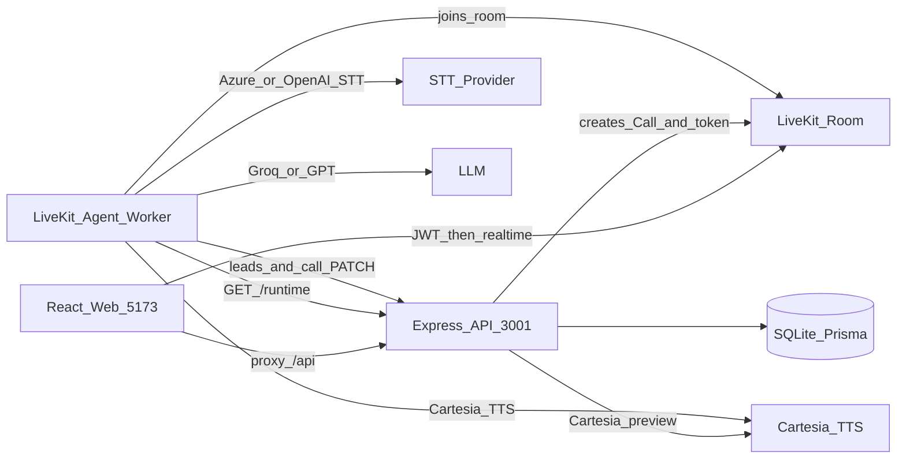
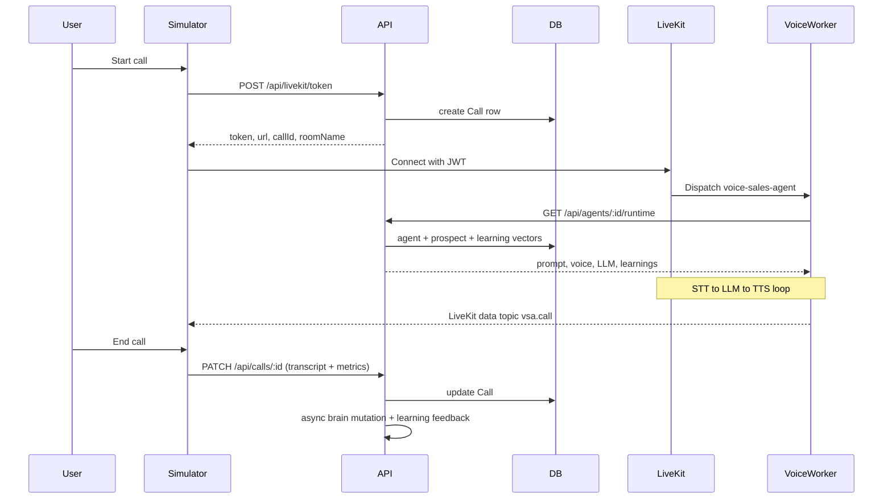

# System Architecture

Voice Sales Agent is a monorepo for configuring voice sales agents (**Agent Studio**) and testing them live (**Call Simulator**).

This document is the top-level map. For detail, see:

- [BACKEND.md](./BACKEND.md) — Express API, database, LiveKit voice worker
- [FRONTEND.md](./FRONTEND.md) — React UI, API client, page flows

---

## What the product does

1. **Agent Studio** — Create and edit agents: identity, Cartesia voice, product Brain (markdown), sales Skills, LLM provider (Groq or GPT), STT provider (Azure or OpenAI), and post-call learnings review.
2. **Call Simulator** — Start an inbound or outbound voice call over LiveKit, talk to the agent, see live transcript / latency / cost estimates, and save the call summary.

On **Save** in Studio, Brain markdown + default Skills are compiled into a stored `compiledSystemPrompt`. The voice worker loads that (plus retrieved learnings and prospect memory) once per call via the API runtime endpoint.

---

## Stack

| Layer | Tech |
|-------|------|
| Frontend | React 19 + Vite 6 (`apps/web`, port 5173) |
| Backend API | Node.js + Express (`apps/api`, port 3001) |
| Database | Prisma → **SQLite** locally (`apps/api/prisma`); Docker Compose provides optional Postgres |
| Voice worker | LiveKit Agents (`apps/agent`) |
| STT | Azure Speech **or** OpenAI transcription (per agent) |
| LLM | Groq **or** OpenAI GPT (per agent) |
| TTS | Cartesia (call audio + Studio preview) |
| Realtime | LiveKit |
| Shared lib | `@vsa/shared` — prompt compiler, skills, learning helpers, cost estimates |

**Security note:** There is no user login. The Express API is open on localhost; protection is CORS (`CORS_ORIGIN`) only. LiveKit JWTs protect room join, not the REST API.

---

## Monorepo layout

```
apps/
  api/       Express + Prisma + LiveKit token / agents / TTS preview / learnings
  agent/     LiveKit voice worker (Azure|OpenAI STT → LLM → Cartesia TTS)
  web/       React UI (Studio + Simulator)
packages/
  shared/    Prompt compiler (Brain + Skills → system prompt), learning helpers
```

Local run needs **three processes**:

```bash
npm run dev:api      # http://localhost:3001
npm run dev:agent    # LiveKit agent worker (agentName: voice-sales-agent)
npm run dev:web      # http://localhost:5173  (proxies /api → :3001)
```

---

## High-level architecture



| Consumer | How it talks to the API |
|----------|-------------------------|
| Web UI | `fetch('/api/...')` via Vite proxy |
| Voice worker | `API_URL` (default `http://localhost:3001`) for `/runtime`, leads, call transcript |

---

## End-to-end call flow



---

## Cross-cutting concepts

### Brain + Skills → system prompt

- **Brain** = product knowledge markdown edited in Studio.
- **Skills** = sales playbooks (demo offer, busy/callback, off-topic, competitor, timepass). Defaults come from `@vsa/shared`.
- On create/update, the API:
  1. Optionally summarizes Brain → `brainSummary` (LLM).
  2. Compiles Brain + Skills + persona/language/gender → `compiledSystemPrompt`.
  3. Stores token estimate in `promptTokenCount`.

### Call directions

| Direction | Behavior |
|-----------|----------|
| **Inbound** | Caller speaks first |
| **Outbound** | Worker generates an opener first (optional `prospectName` for memory) |

### Learnings / mutations

After a call ends with a transcript, the API runs **brain mutation** asynchronously:

- Extract global playbook learnings and prospect facts via LLM.
- Some categories auto-apply; others are **held** for approve/reject in Studio Learnings.
- Global learnings are also stored as **vectors** (OpenAI embeddings) and retrieved at call time on `/runtime`.

### In-call path vs REST

During a live call, speech does **not** go through Express. Audio and realtime metadata flow over LiveKit between the browser and the agent worker. REST is used to mint the token, load runtime config, capture leads/callbacks, and save the transcript at the end.

---

## Environment (by service)

| Variable | Used by |
|----------|---------|
| `DATABASE_URL` | API (Prisma) |
| `API_PORT`, `CORS_ORIGIN` | API |
| `LIVEKIT_URL`, `LIVEKIT_API_KEY`, `LIVEKIT_API_SECRET` | API (tokens), Agent |
| `AZURE_SPEECH_KEY`, `AZURE_SPEECH_REGION` | Agent (Azure STT) |
| `GROQ_API_KEY` / `OPENAI_API_KEY` | API (summary/mutation) + Agent (dialogue LLM + OpenAI STT) |
| `CARTESIA_API_KEY` | API (preview), Agent (TTS) |
| `API_URL` | Agent (load agent config) |

See [`.env.example`](../.env.example) for the full list.

---

## Next reads

1. [BACKEND.md](./BACKEND.md) — routes, Prisma models, agent pipeline
2. [FRONTEND.md](./FRONTEND.md) — Studio tabs, Simulator, `api.ts` map
