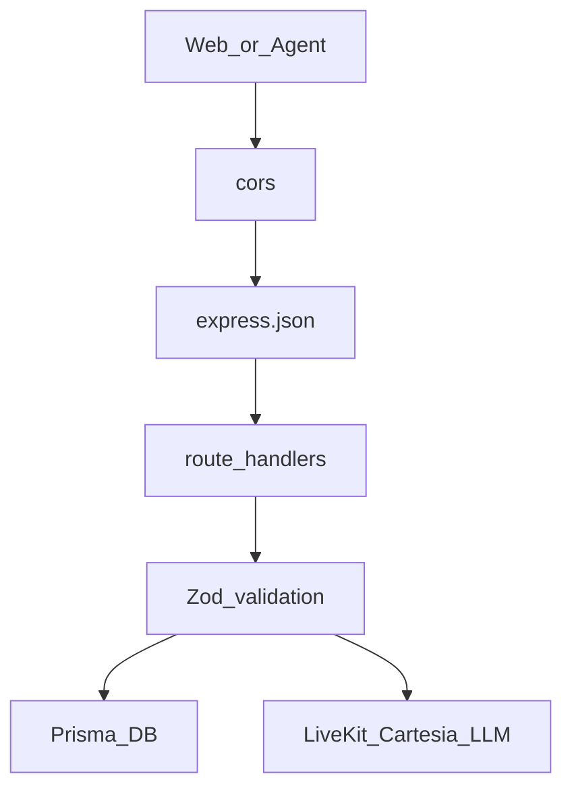
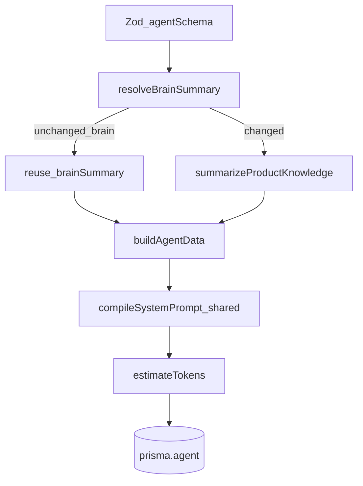
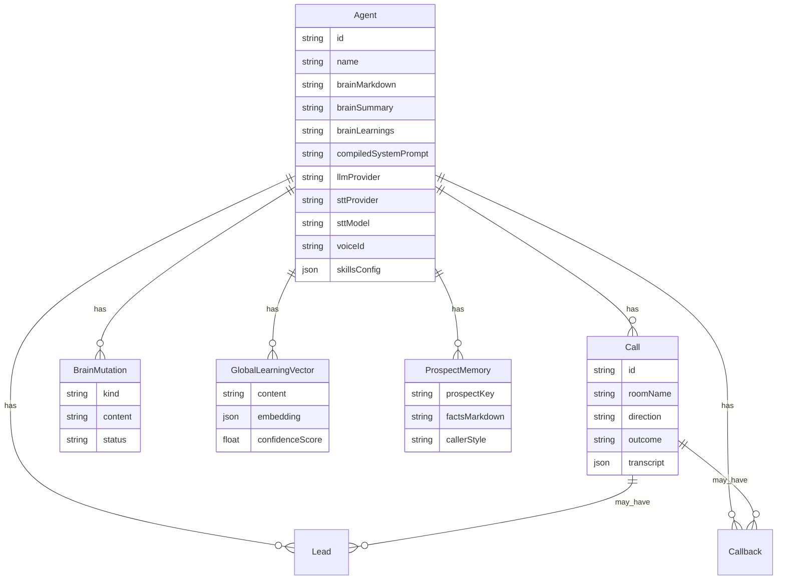
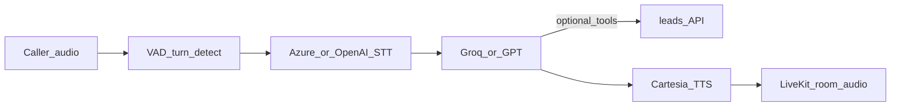
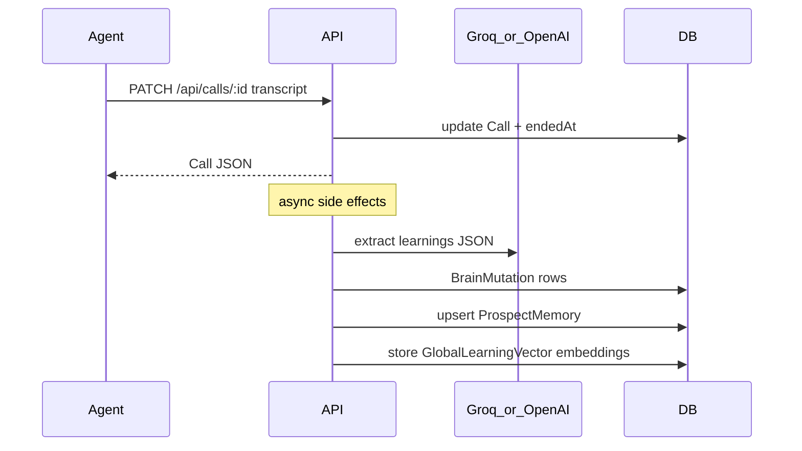

# Backend Documentation

The backend has two runtime pieces:

1. **Express API** (`apps/api`) — REST, Prisma DB, LiveKit tokens, TTS preview, post-call learnings
2. **LiveKit voice worker** (`apps/agent`) — realtime STT → LLM → TTS on each call

Shared logic lives in `packages/shared` (`@vsa/shared`).

For the full-system view, see [ARCHITECTURE.md](./ARCHITECTURE.md).

---

## 1. Express API

**Entry:** [`apps/api/src/index.ts`](../apps/api/src/index.ts)

| Concern | Behavior |
|---------|----------|
| Port | `API_PORT` (default **3001**) |
| CORS | `CORS_ORIGIN` (default `http://localhost:5173`) |
| Body | `express.json({ limit: '2mb' })` |
| Auth | **None** — no JWT/session on REST routes |
| Health | `GET /health` → `{ ok: true }` |

Mounted routers:

```text
/api/agents   → agentsRouter (+ nested mutations)
/api/calls    → callsRouter
/api/livekit  → livekitRouter
/api/leads    → leadsRouter
/api/tts      → ttsRouter
```



---

## 2. API reference

### Agents — [`routes/agents.ts`](../apps/api/src/routes/agents.ts)

| Method | Path | Purpose |
|--------|------|---------|
| `GET` | `/api/agents` | List agents (summary fields) |
| `POST` | `/api/agents` | Create agent: summarize Brain, compile prompt, persist |
| `GET` | `/api/agents/:id` | Full agent record |
| `PUT` | `/api/agents/:id` | Update agent; re-summarize Brain if markdown changed |
| `DELETE` | `/api/agents/:id` | Delete agent (`204`) |
| `GET` | `/api/agents/:id/runtime` | Runtime payload for voice worker (`?prospectName=` optional) |
| `GET` | `/api/agents/:id/learning-stats` | Vector count + confidence aggregates |
| `GET` | `/api/agents/:id/prospects` | Prospect memories (last 50) |

**Save pipeline (create / update):**



**`/runtime` pipeline:** Load agent → load `ProspectMemory` by prospect key → (optional) backfill vectors from `brainLearnings` text → embed retrieval query → top-K `GlobalLearningVector` → return compiled prompt + voice/LLM config + retrieved learnings + prospect memory.

### Mutations — [`routes/mutations.ts`](../apps/api/src/routes/mutations.ts)

Nested under `/api/agents/:id/mutations`:

| Method | Path | Purpose |
|--------|------|---------|
| `GET` | `/` | List mutations (`?status=&limit=`) |
| `POST` | `/clear-learnings` | Clear text learnings + vectors |
| `POST` | `/:mutationId/approve` | Approve held learning → append + vector |
| `POST` | `/:mutationId/reject` | Reject held learning |

### Calls — [`routes/calls.ts`](../apps/api/src/routes/calls.ts)

| Method | Path | Purpose |
|--------|------|---------|
| `PATCH` | `/api/calls/:id` | Persist transcript / metrics / outcome; end call |

Side effects (async, after response may already be in flight):

1. **Outcome priority:** `demo_booked` > `callback_scheduled` > `completed`
2. **Outcome feedback** on recent learning vectors (success / failure signal)
3. If transcript present → **`runBrainMutation(callId)`**

### LiveKit — [`routes/livekit.ts`](../apps/api/src/routes/livekit.ts)

| Method | Path | Purpose |
|--------|------|---------|
| `POST` | `/api/livekit/token` | Create `Call` row + LiveKit AccessToken |

Request body: `{ agentId, participantName?, direction?, prospectName? }`

Token metadata embeds `agentId`, `callId`, `direction`, optional `prospectName`.  
`roomConfig.agents = [{ agentName: 'voice-sales-agent' }]` so LiveKit dispatches the worker.  
Response: `{ token, url, roomName, callId, agentId }`.

### Leads — [`routes/leads.ts`](../apps/api/src/routes/leads.ts)

| Method | Path | Purpose |
|--------|------|---------|
| `POST` | `/api/leads` | Capture demo lead; sets call outcome `demo_booked` |
| `POST` | `/api/leads/callback` | Schedule callback; sets `callback_scheduled` |
| `GET` | `/api/leads/agent/:agentId` | Leads + callbacks for an agent |

Used primarily by **agent tools** during a call (not by the React Studio today).

### TTS — [`routes/tts.ts`](../apps/api/src/routes/tts.ts)

| Method | Path | Purpose |
|--------|------|---------|
| `GET` | `/api/tts/models` | Cartesia model list |
| `GET` | `/api/tts/languages` | Language list |
| `GET` | `/api/tts/voices` | Voices from Cartesia (filtered catalog) |
| `POST` | `/api/tts/preview` | Returns `audio/wav` from Cartesia `/tts/bytes` |

Studio preview uses this path. **Call audio TTS** runs inside the agent worker, not through these routes.

---

## 3. Supporting API modules

| File | Role |
|------|------|
| [`db.ts`](../apps/api/src/db.ts) | Singleton `PrismaClient` |
| [`llm-chat.ts`](../apps/api/src/llm-chat.ts) | Chat / JSON LLM calls (Groq or OpenAI) for summary + mutation |
| [`brain-summary.ts`](../apps/api/src/brain-summary.ts) | Compress `brainMarkdown` → `brainSummary` on save |
| [`brain-mutation.ts`](../apps/api/src/brain-mutation.ts) | Post-call extract / auto-apply / approve / reject / clear |
| [`vector-learnings.ts`](../apps/api/src/vector-learnings.ts) | OpenAI embeddings, cosine retrieval, confidence feedback |
| [`cartesia.ts`](../apps/api/src/cartesia.ts) | Voice catalog helpers for Studio |

---

## 4. Data model

**Schema:** [`apps/api/prisma/schema.prisma`](../apps/api/prisma/schema.prisma)

Provider is **SQLite** (`DATABASE_URL`, typically `file:./dev.db`). Docker Compose can run Postgres for production-style setups; switch Prisma provider/`DATABASE_URL` accordingly.



| Model | Purpose |
|-------|---------|
| **Agent** | Voice, LLM, Brain, learnings, compiled prompt, skills JSON |
| **Call** | Room, direction, prospect, outcome, transcript JSON |
| **Lead** | Demo booking (name, email, preferred time) |
| **Callback** | Callback request (`status` default `pending`) |
| **BrainMutation** | Audit of learning pipeline (`held`, `auto_applied`, `approved`, `rejected`, …) |
| **GlobalLearningVector** | Embedded playbook bullets + uses/success/failure counters |
| **ProspectMemory** | Per-prospect facts + caller style (`@@unique([agentId, prospectKey])`) |

---

## 5. Voice agent worker

**Package:** `apps/agent`  
**Agent name:** `voice-sales-agent` (must match LiveKit room dispatch)

### Entry — [`main.ts`](../apps/agent/src/main.ts)

1. Connect to the LiveKit room.
2. Wait for participant.
3. Resolve agent + call metadata (`resolveAgentFromRoom`).
4. Start `voice.AgentSession` with the agent’s selected STT provider (Azure or OpenAI) + VAD turn handling.
5. Attach telemetry + transcript persistence.
6. If **outbound**, generate opener first (`toolChoice: 'none'`).

### Resolve config — [`load-agent.ts`](../apps/agent/src/load-agent.ts)

- Reads `agentId` / `callId` / `direction` / `prospectName` from participant or room metadata (fallback: parse agent UUID from `roomName` `call-{uuid}-…`).
- `GET {API_URL}/api/agents/:id/runtime?prospectName=…`

### Build voice agent — [`voice-agent.ts`](../apps/agent/src/voice-agent.ts)

Assembles final instructions:

1. Refresh language + gender rules on stored `compiledSystemPrompt`
2. Retrieved global learnings block
3. Prospect memory + caller-style blocks
4. Inbound / outbound direction prompt

Wires:

- LLM via [`llm-factory.ts`](../apps/agent/src/llm-factory.ts) (Groq or GPT)
- STT via [`stt-factory.ts`](../apps/agent/src/stt-factory.ts) (Azure Speech or OpenAI streaming transcription)
- Multilingual Cartesia TTS via [`multilingual-tts.ts`](../apps/agent/src/multilingual-tts.ts)
- Tools via [`tools.ts`](../apps/agent/src/tools.ts) (demo lead + callback → `/api/leads`)

### Speech pipeline



Other worker modules:

| File | Role |
|------|------|
| [`stt-factory.ts`](../apps/agent/src/stt-factory.ts) | Select Azure or OpenAI STT from agent config |
| [`azure-stt.ts`](../apps/agent/src/azure-stt.ts) | Azure Speech STT (phrase lists, confidence) |
| [`call-vad.ts`](../apps/agent/src/call-vad.ts) | Voice activity / endpointing |
| [`call-transcript.ts`](../apps/agent/src/call-transcript.ts) | Persist / publish transcript; PATCH call on close |
| [`call-telemetry.ts`](../apps/agent/src/call-telemetry.ts) | Metrics on LiveKit data topic `vsa.call` |

---

## 6. Post-call learning flow



- Abuse / duplicates may be skipped.
- Some categories auto-apply (capped per call); pricing/gap-style items often stay **held** for Studio approve/reject.
- PATCH returns before mutation finishes (eventual consistency).

---

## 7. Shared package (`@vsa/shared`)

**Path:** [`packages/shared/src`](../packages/shared/src)

| Module | Used for |
|--------|----------|
| `compileSystemPrompt` / `DEFAULT_SKILLS` | API agent save |
| Language / Hinglish helpers | API TTS preview + agent prompts |
| Learning retrieval / mutation text rules | API + runtime |
| Cost / usage helpers | Frontend Simulator estimates |

The shared package is not an HTTP service; it is the behavioral contract for prompts and learnings across API, agent, and web.

---

## 8. External integrations (API + agent)

| Service | API | Agent |
|---------|-----|-------|
| LiveKit Cloud | Mint JWT | Join room, audio, data |
| Groq | Brain summary / mutation (if provider=groq) | Dialogue LLM |
| OpenAI | Chat (gpt) + **embeddings** for vectors | Dialogue LLM (gpt) + OpenAI STT |
| Cartesia | Studio preview WAV | Call TTS |
| Azure Speech | — | Azure STT (default) |

---

## Related docs

- [ARCHITECTURE.md](./ARCHITECTURE.md) — system overview
- [FRONTEND.md](./FRONTEND.md) — how the UI calls these APIs
