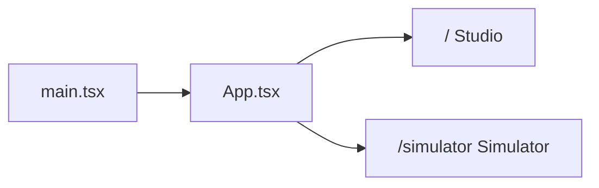
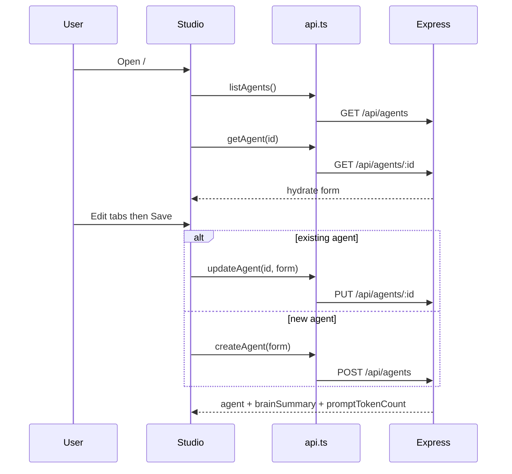
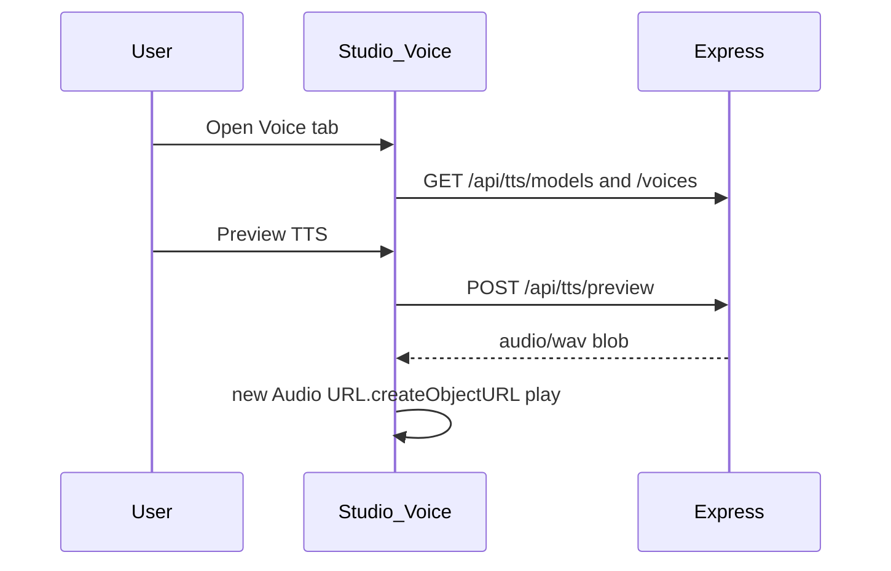
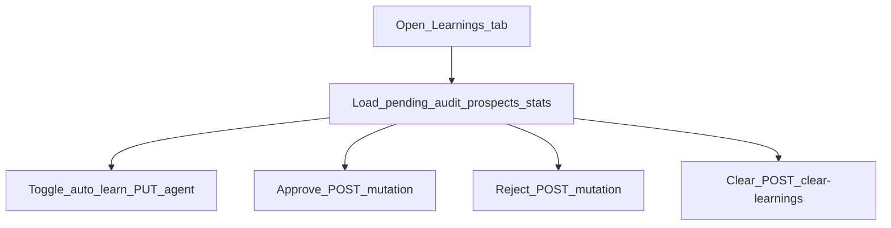
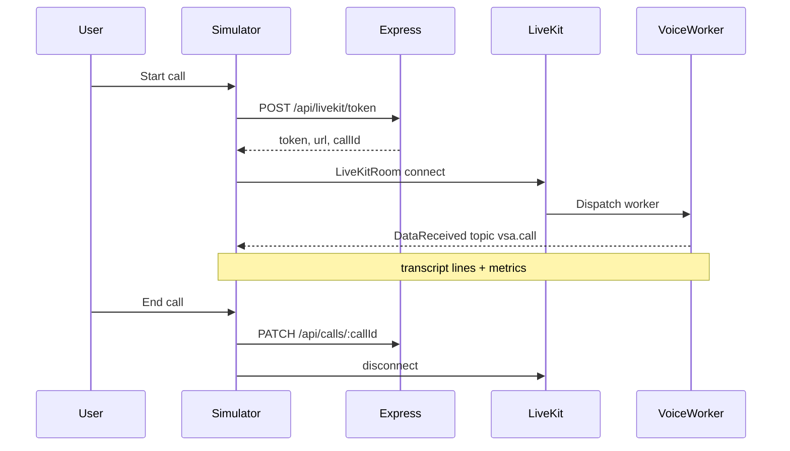
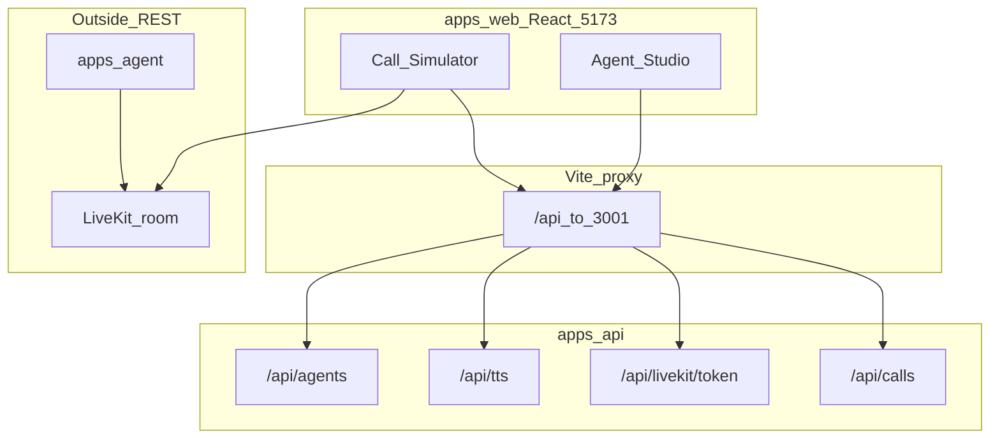

# Frontend Documentation

The frontend is a compact React SPA in `apps/web` (**@vsa/web**). There is **no login**, **no global state library**, and almost all UI lives in two pages plus one API module.

For the full-system view, see [ARCHITECTURE.md](./ARCHITECTURE.md). For API/agent detail, see [BACKEND.md](./BACKEND.md).

---

## 1. Stack and layout

| Concern | Choice |
|---------|--------|
| UI | React 19 |
| Bundler | Vite 6 (port **5173**) |
| Routing | `react-router-dom` v7 |
| Realtime voice | `livekit-client` + `@livekit/components-react` |
| HTTP | Native `fetch` (no axios) |
| Styling | Plain CSS (`index.css`) |
| Shared | `@vsa/shared` (skills types, cost helpers) |

```
apps/web/src/
  main.tsx          React root + BrowserRouter + LiveKit CSS
  App.tsx           Shell nav + routes
  api.ts            All REST client calls
  index.css         Global styles
  pages/
    Studio.tsx      Agent Studio (/)
    Simulator.tsx   Call Simulator (/simulator)
```

**Start:** `npm run dev:web` → http://localhost:5173

**Dev proxy** ([`vite.config.ts`](../apps/web/vite.config.ts)): browser `/api/*` → `http://localhost:3001/api/*`

**Auth:** none on REST. LiveKit join uses a JWT returned by `POST /api/livekit/token`.

Optional frontend env: `VITE_CARTESIA_VOICE_ID` (default voice in Studio). API keys stay on the API / agent.

---

## 2. App shell and routing

[`App.tsx`](../apps/web/src/App.tsx):

| Route | Page | Role |
|-------|------|------|
| `/` | `StudioPage` | Configure agents |
| `/simulator` | `SimulatorPage` | Live voice call testing |



Header nav: **Agent Studio** | **Call Simulator**.

---

## 3. API client (`api.ts`)

**Base:** `const API = '/api'`

| Function | Method | Path | Used by |
|----------|--------|------|---------|
| `listAgents` | `GET` | `/api/agents` | Studio, Simulator |
| `getAgent` | `GET` | `/api/agents/:id` | Studio |
| `createAgent` | `POST` | `/api/agents` | Studio (new) |
| `updateAgent` | `PUT` | `/api/agents/:id` | Studio save / learnings toggle |
| `getLiveKitToken` | `POST` | `/api/livekit/token` | Simulator start |
| `saveCallSummary` | `PATCH` | `/api/calls/:callId` | Simulator end |
| `listTtsModels` | `GET` | `/api/tts/models` | Studio Voice |
| `listTtsVoices` | `GET` | `/api/tts/voices` | Studio Voice |
| `listTtsLanguages` | `GET` | `/api/tts/languages` | Exported (not used by Studio UI today) |
| `previewTts` | `POST` | `/api/tts/preview` | Studio Preview (returns audio blob) |
| `getGlobalLearningStats` | `GET` | `/api/agents/:id/learning-stats` | Studio Learnings |
| `listMutations` / pending / audit | `GET` | `/api/agents/:id/mutations?...` | Studio Learnings |
| `clearBrainLearnings` | `POST` | `/api/agents/:id/mutations/clear-learnings` | Studio |
| `approveMutation` | `POST` | `.../mutations/:id/approve` | Studio |
| `rejectMutation` | `POST` | `.../mutations/:id/reject` | Studio |
| `listProspectMemories` | `GET` | `/api/agents/:id/prospects` | Studio Learnings |

**Not called by the web UI:** `/api/leads/*`, `DELETE /api/agents/:id`, `GET /api/agents/:id/runtime` (voice worker only).

---

## 4. Agent Studio

**File:** [`pages/Studio.tsx`](../apps/web/src/pages/Studio.tsx)

State is local `useState` only (no Redux/Context).

### Tabs (in-page)

| Tab | What the user does |
|-----|--------------------|
| **Identity** | Name, product, greeting, persona |
| **Voice** | TTS model, speak languages (en / hi / hinglish), Cartesia voice, gender, speed/pitch, preview |
| **Brain** | Edit product markdown; view LLM-generated summary (read-only after save) |
| **Skills** | Read-only sales playbooks from `DEFAULT_SKILLS` |
| **Learnings** | Auto-learn toggle, approve/reject held mutations, clear learnings, prospect memories |
| **LLM** | Groq vs GPT (+ GPT model choice) |
| **STT** | Azure Speech vs OpenAI STT (+ OpenAI model choice) |

### Load + save flow



Save sends form fields (identity, voice, brain markdown, LLM, STT). Skills stay server defaults. Brain **summary** is produced on the API on save.

### Voice preview



### Learnings review



---

## 5. Call Simulator

**File:** [`pages/Simulator.tsx`](../apps/web/src/pages/Simulator.tsx)

### Phases

1. **Pre-call** — pick agent, inbound/outbound, optional prospect name → Start call  
2. **In-call** — `LiveKitRoom` + session UI (transcript, latency, usage/cost)  
3. **Post-call** — summary panel after End call  

### Start / end call



| Direction | UI behavior |
|-----------|-------------|
| **Inbound** | User speaks first |
| **Outbound** | Agent opener first; optional prospect name for memory |

### In-call data (not REST)

The agent publishes JSON on LiveKit topic **`vsa.call`** (transcript + metrics). The Simulator listens via `RoomEvent.DataReceived` and updates local state. Cost estimates use `@vsa/shared` helpers (`usageFromMetrics`, `estimateCallCost`) from the selected agent's LLM provider.

---

## 6. Mental model: UI vs realtime



**Takeaway:** The frontend is a thin configuration + call console. Hard realtime (STT → LLM → TTS) happens between the browser and the agent worker over LiveKit—not via repeated REST during the call.

---

## Related docs

- [ARCHITECTURE.md](./ARCHITECTURE.md) — system overview
- [BACKEND.md](./BACKEND.md) — API routes, Prisma, voice worker
